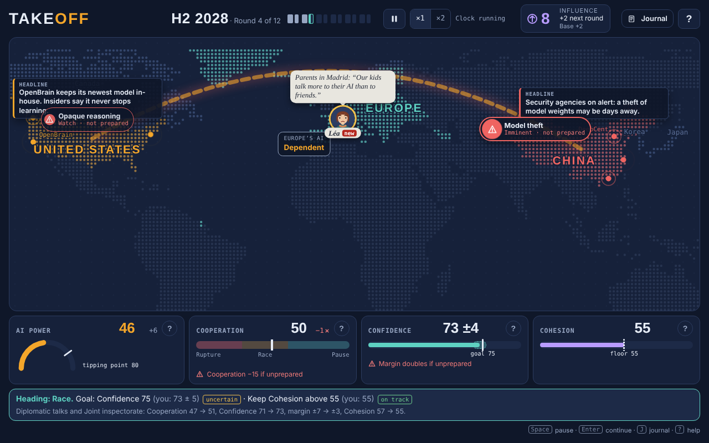
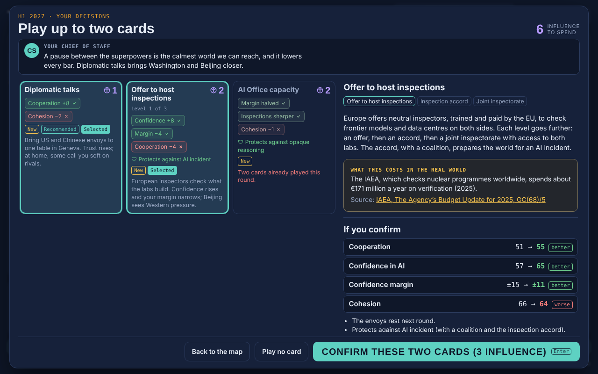
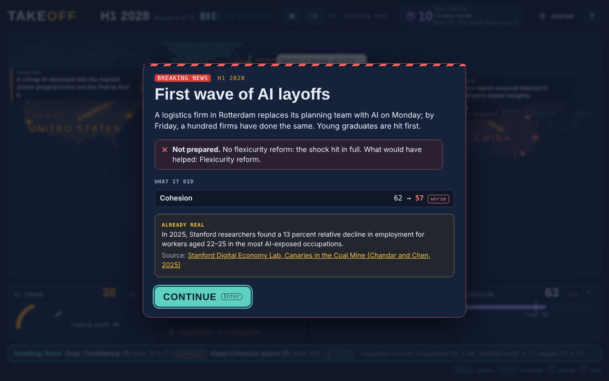
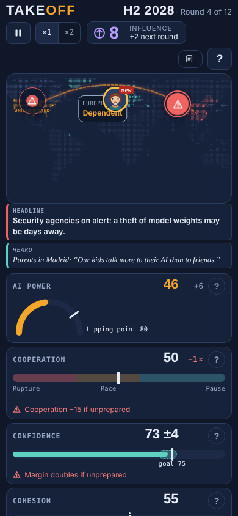

# Takeoff: Europe’s Next Move

A Plague Inc.-style browser game about AI governance for the general public. You are the EU's AI Envoy: you cannot stop the US–China race, but you can prepare the world for the moment AI starts improving itself. Ten rounds of six months (2027–2031); one AI clock, a Cooperation heading, two pillars (Confidence in AI, Cohesion) and one resource, Influence.

- Game design spec (v3): [docs/V3_SPEC.md](docs/V3_SPEC.md)
- What the game takes from AI 2027 and CFG: [docs/SCENARIO_BASIS.md](docs/SCENARIO_BASIS.md)
- Exact rules and numbers: [docs/DEVELOPER_NOTES.md](docs/DEVELOPER_NOTES.md)
- How v3 was built, realism notes, known issues: [docs/V3_BUILD_NOTES.md](docs/V3_BUILD_NOTES.md)

## Develop

```sh
npm install
npm run dev      # local server
npm test         # unit tests: engine rules, scenario basis, hidden values, content, balance sample, UI helpers
npm run test:coverage   # the same, with a coverage report of src/
npm run test:e2e        # plays whole games in Chromium (npx playwright install chromium once)
npm run a11y            # keyboard-only games with axe on every screen
node scripts/shots.mjs docs/screenshots/v3   # screenshots of every screen
npm run sim      # simulate thousands of games and print the ending distribution
npm run build    # production build in dist/ (with a Content-Security-Policy meta tag)
npm run typecheck
npm run lint     # ESLint (typescript-eslint recommended rules)
```

Pushing to `main` deploys to GitHub Pages; every other branch gets a preview at `/takeoff-middle-power/preview/<branch>/` (Settings → Pages → Source: Deploy from a branch, `gh-pages`, `/`). See `.github/workflows/deploy.yml`.

## Screens

| | |
| --- | --- |
|  |  |
|  |  |

## Licence

Copyright © 2026 Damien Le Thiec, Louis Bonneau and Marcin Rabiza. **All rights reserved** — see [LICENSE](LICENSE). You may play the game and read this repository, but not copy, modify or reuse any part of it without the authors’ written permission. Fonts are under the SIL Open Font License; the scenarios the game cites (AI 2027, CFG, Europe 2031) belong to their authors.
