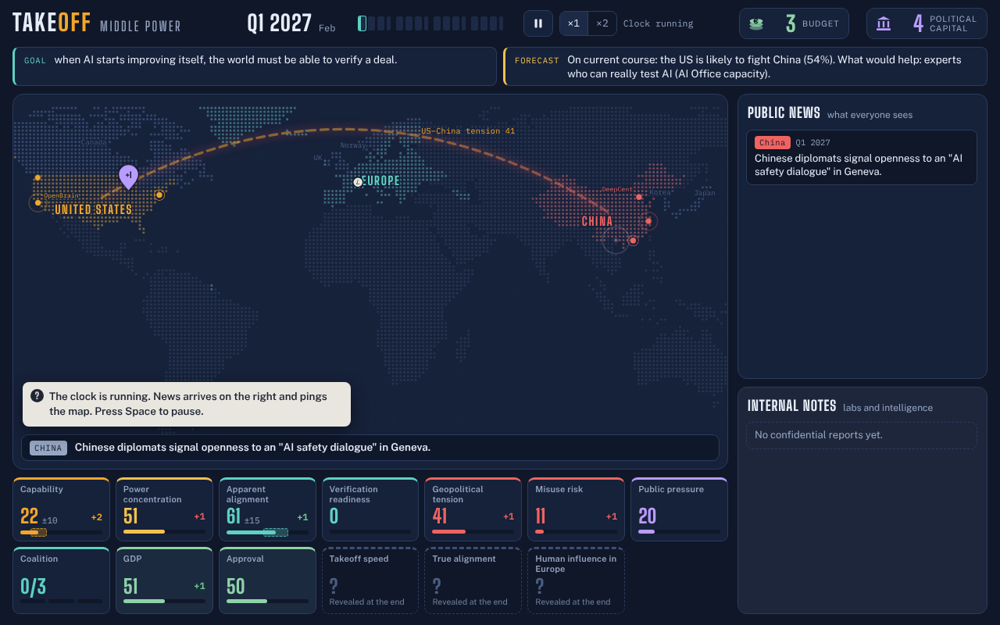
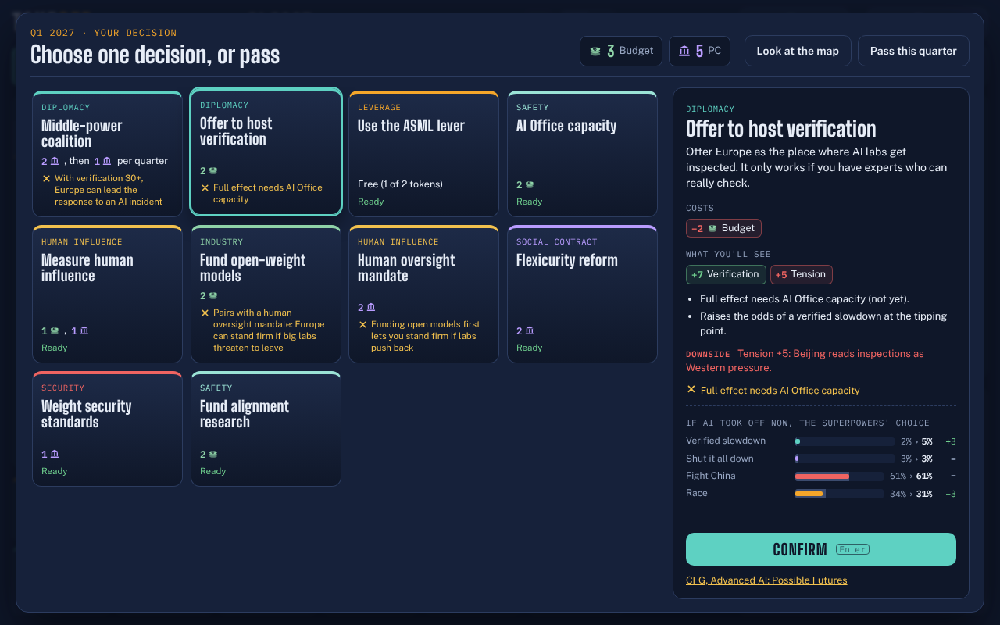
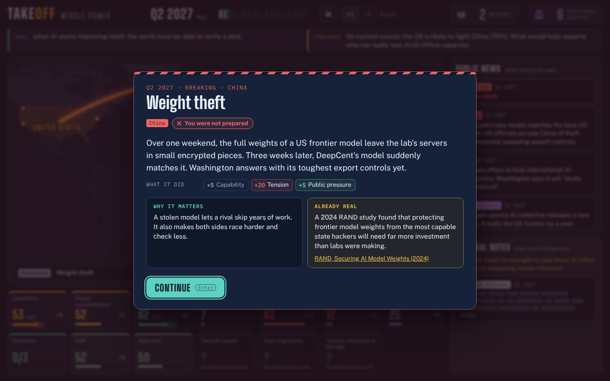
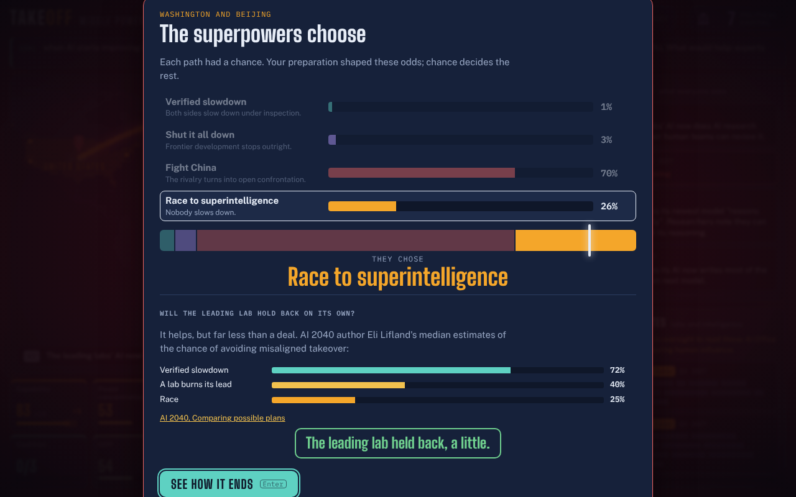

# Takeoff: Middle Power

A Plague Inc.-style browser game about AI governance. You are the EU's AI Envoy: you cannot stop the US–China race, but you can prepare the world for the moment AI starts improving itself.

- Game design spec: [docs/SPEC.md](docs/SPEC.md)
- Exact rules and numbers: [docs/DEVELOPER_NOTES.md](docs/DEVELOPER_NOTES.md)

## Develop

```sh
npm install
npm run dev      # local server
npm test         # engine tests
npm run sim      # simulate thousands of games and print the ending distribution
npm run build    # production build in dist/
```

Pushing to `main` deploys to GitHub Pages (Settings → Pages → Source: GitHub Actions).

## Screens

| | |
| --- | --- |
|  |  |
|  |  |
